# Azyon CRM — sistema operacional de vendas com IA para WhatsApp

CRM desenvolvido para a **Azyon Tech**, uma agência de IA, para a operação comercial dela. Junta inbox de
WhatsApp, agentes de IA que atendem e qualificam, funis, prospecção (scraper de mapa, cold call,
disparo e e-mail) e o financeiro da agência, com estrutura multi-empresa pronta para virar SaaS.

> **Código-fonte privado** — esta página mostra o que o sistema faz. As telas são de uma
> instalação de demonstração com uma empresa fictícia ("Clínica Bem Viver"): nenhum dado real.
> Acesso ao código para avaliação técnica sob solicitação.
>
> **Base open source:** o Azyon é construído sobre o [DeskcommCRM](https://github.com/melgarafael/DeskcommCRM)
> (MIT), projeto do qual também sou contribuidor (função de Cold Call, PR mergeado). Em cima dessa base
> adaptei o produto para a agência e conduzi o desenvolvimento dos módulos marcados com ★ abaixo.
>
> **Como foi feito:** conduzi o projeto (ideia, regras de negócio, validação e publicação) com apoio de
> ferramentas de IA (Claude Code) para escrever o código.

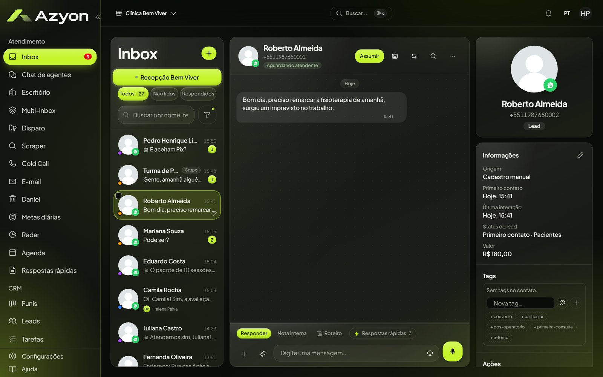

## O problema

Uma agência pequena prospecta e atende pelo WhatsApp com várias pessoas e vários números ao mesmo
tempo. Sem sistema, lead se perde entre celulares, ninguém sabe quem respondeu quem, a meta do dia
é palpite e o dinheiro que entrou vive numa planilha à parte. O Azyon centraliza o atendimento,
automatiza a prospecção com IA e mostra aos sócios o funil, as metas e o caixa.

## Funcionalidades

**Atendimento**
- Inbox de WhatsApp com ficha do lead, notas internas, respostas rápidas e "IA digitando"
- Agentes de IA que atendem, qualificam e movem o funil, com mapa de quem está atendendo quem
- ★ **Escritório**: visão em pixel art de cada área do CRM e dos agentes trabalhando
- ★ **Chat de agentes**: cada agente avisa a equipe do que fez no CRM

**Prospecção**
- ★ **Scraper** de empresas por nicho e região com mapa, exportação e envio para o funil
- ★ **Disparo** e **multi-inbox**: campanhas por vários números, meta por inbox, spintax e
  acompanhamento ao vivo de quem recebeu e quem respondeu
- ★ **Cold Call**: fila de ligações, tela de ligação com roteiro, conversa e ações rápidas
  (não atendeu, follow-up, pediu reunião), motivos de perda e meta diária de ligações
- ★ **E-mail** 1 a 1 (Brevo, Gmail ou Resend) com caixa de entrada das respostas
- ★ **Daniel**: rotina que separa os leads que viraram lixo para a equipe limpar, com auditoria e LGPD

**Gestão**
- Funis em quadro, lista e calendário; agenda; radar de leads em risco
- Painel de desempenho com funil comercial e evolução
- ★ **Metas diárias**, **recebimentos** por negócio fechado, **banco** com divisão de lucros entre sócios
- ★ Separação de leads entre dois CRMs que usam o mesmo número ("um número, um dono")

| Escritório dos agentes ★ | Agentes de IA |
|---|---|
| 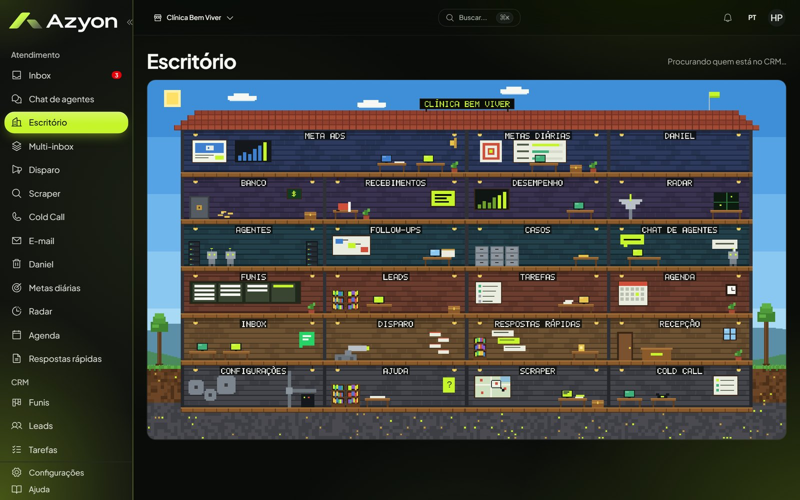 | 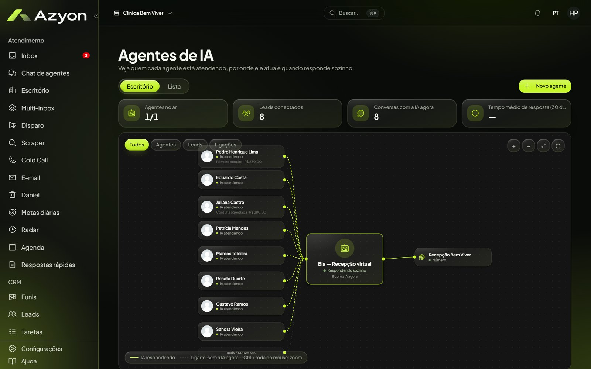 |
| **Funil em quadro** | **Desempenho** |
| 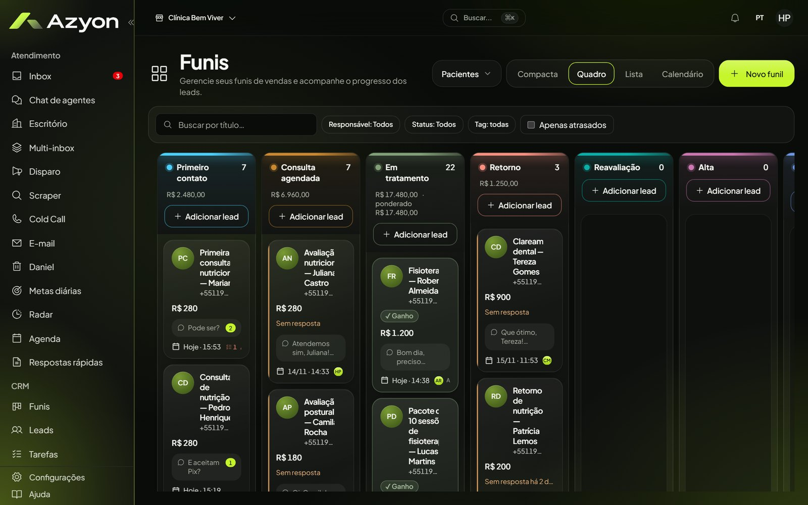 | 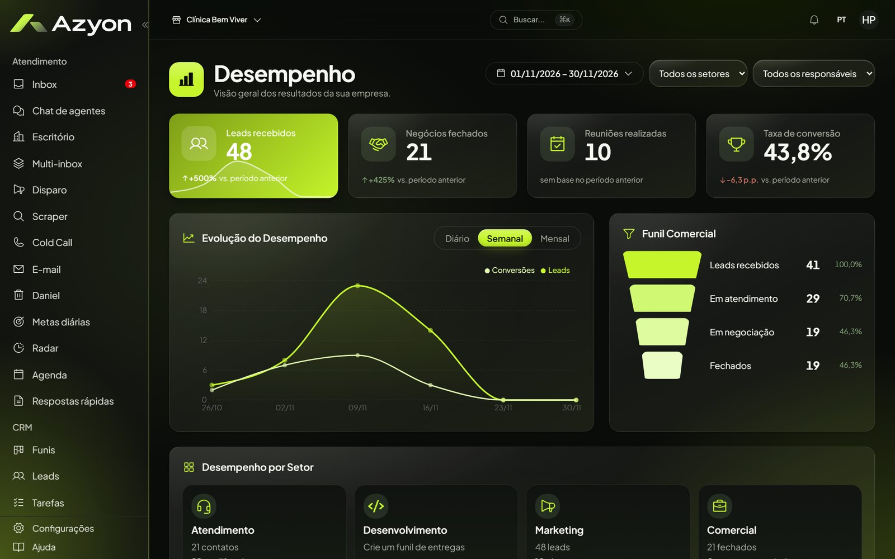 |
| **Disparo ao vivo ★** | **Multi-inbox ★** |
| 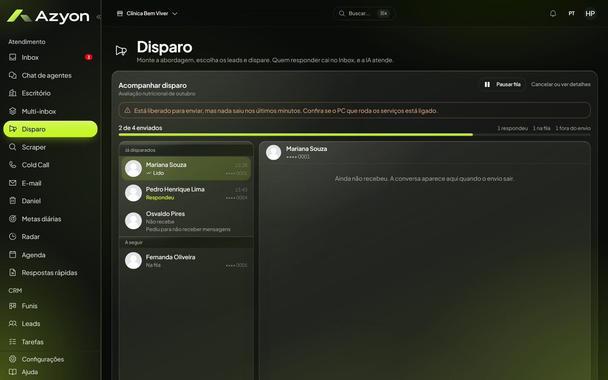 | 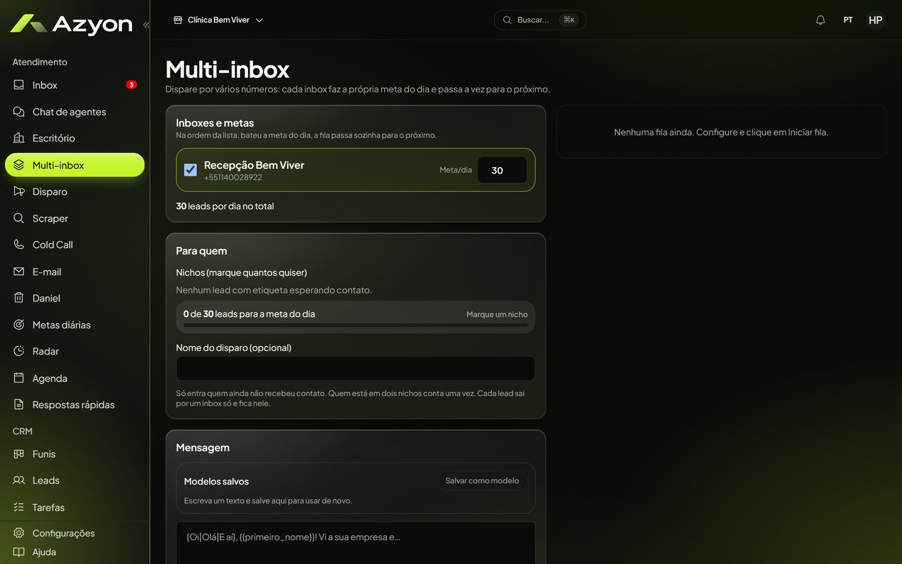 |
| **Scraper com mapa ★** | **Daniel, o faxineiro do CRM ★** |
| 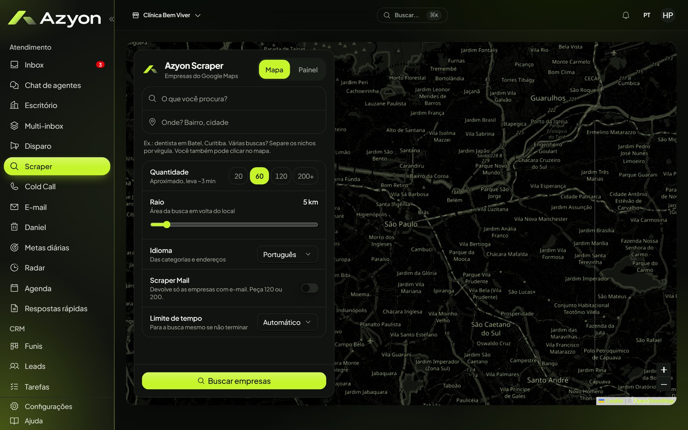 | 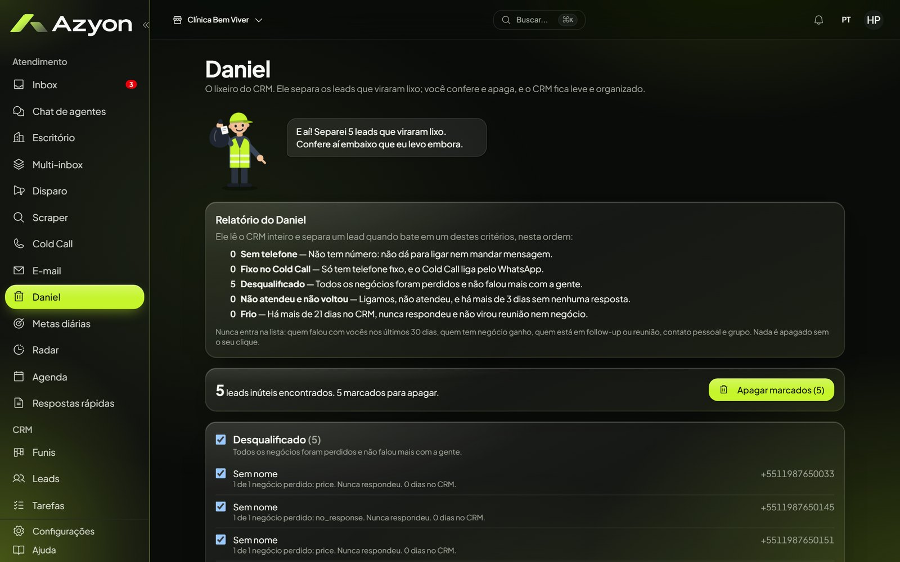 |
| **Agenda** | **Radar de risco** |
| 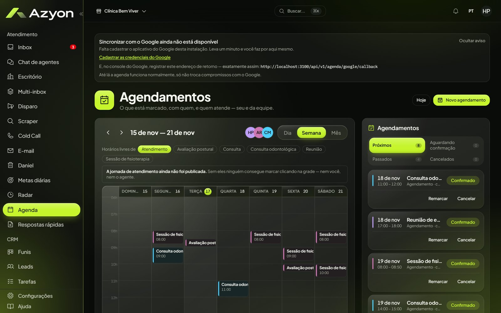 | 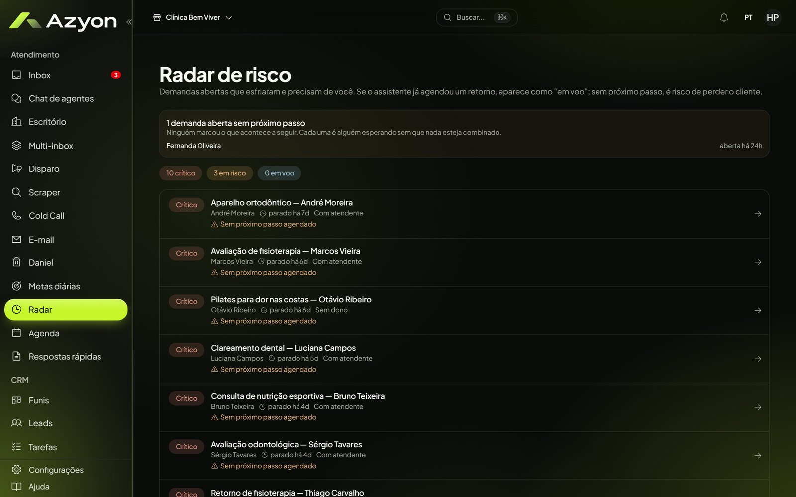 |
| **Leads** | **Recebimentos ★** |
| 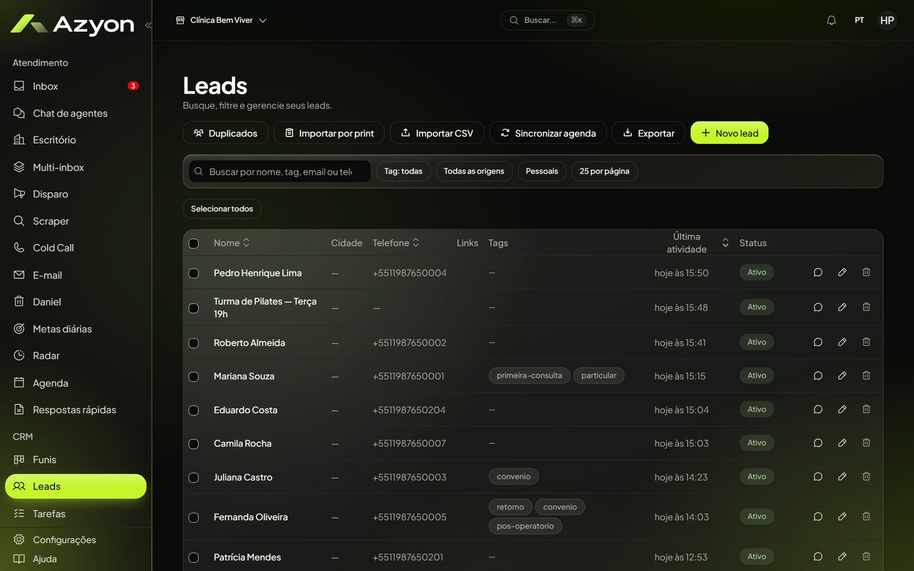 | 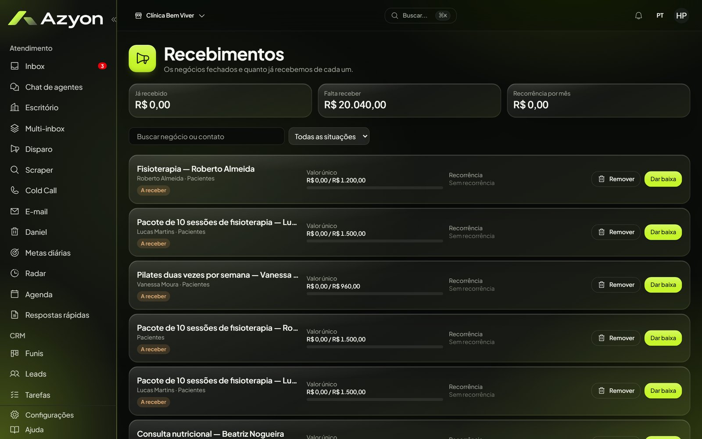 |
| **Cold Call: ligação ★** | **Cold Call: fila de ligações ★** |
| 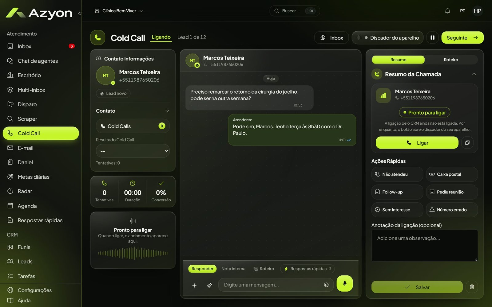 | 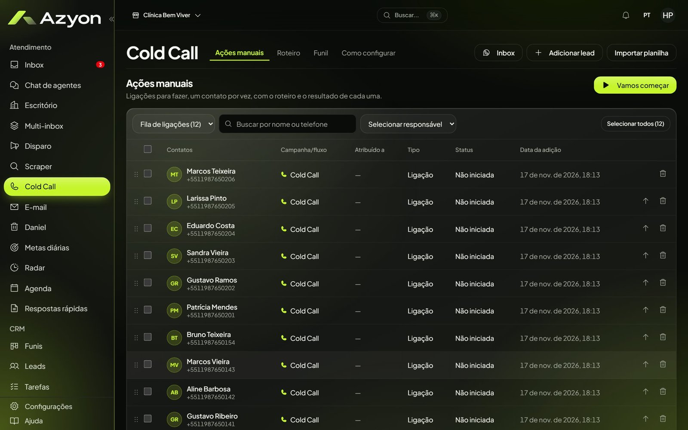 |

## Arquitetura

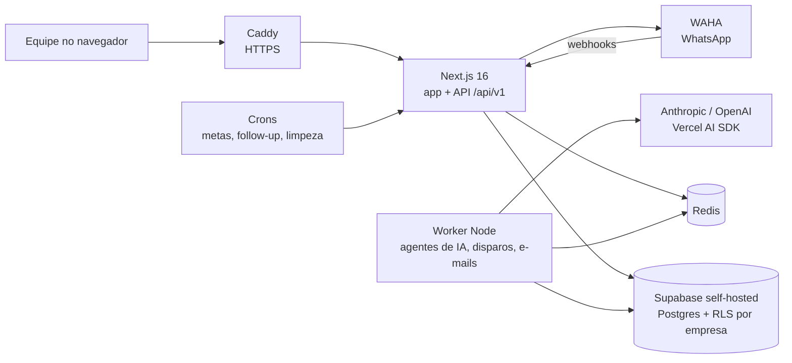

Tudo roda em Docker Compose numa VPS própria (app, worker, crons, WAHA, Redis e Caddy), com o
Supabase também auto-hospedado.

## Stack

`Next.js 16` · `React` · `TypeScript` · `Tailwind` · `Supabase (Postgres, Auth, Realtime, Storage)` ·
`Vercel AI SDK` · `Anthropic` · `OpenAI` · `WAHA (WhatsApp)` · `Redis` · `Docker Compose` · `Caddy` ·
`Vitest` · `Playwright` · `Sentry`

## O que eu aprendi

- **Trabalhar numa base grande que não escrevi** e contribuir de volta para o open source.
- **Regra de negócio no banco:** migrações versionadas, gatilhos e RLS para o que não pode depender da tela.
- **IA aplicada à venda:** agentes que agem no CRM e avisam a equipe, com humanos aprovando o sensível.
- **Levar para produção:** sair da Vercel para uma VPS com Docker, HTTPS, worker, crons e WhatsApp.
- **Pensar em produto:** multi-empresa e bloqueio por plano como base para vender como SaaS.

---

Feito por **Arthur Barreto** — estudante de Ciência da Computação (UFVJM) · [github.com/arthurbarreto07](https://github.com/arthurbarreto07)

© 2026 Arthur Barreto (Azyon Tech). Todos os direitos reservados. Base DeskcommCRM sob licença MIT.
